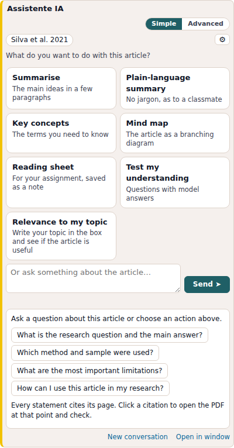
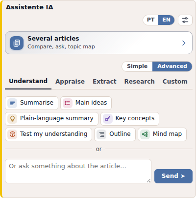
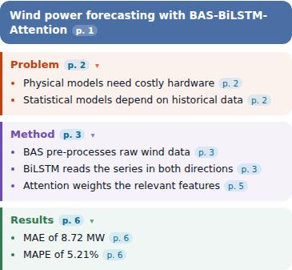
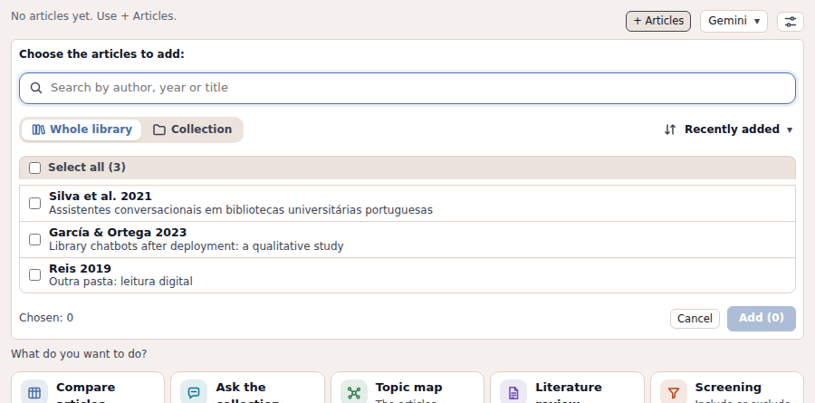
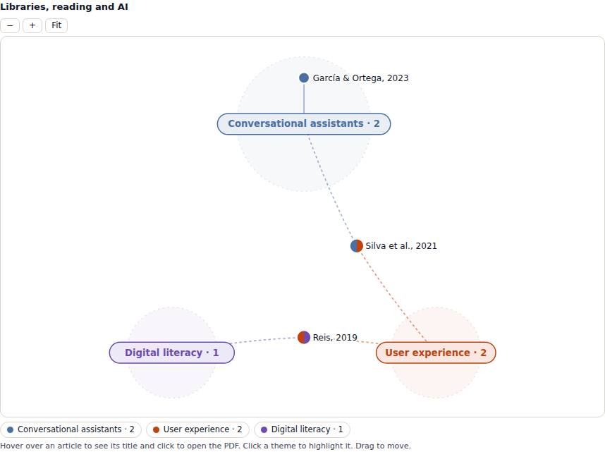

# AI Assistant for Zotero

Read, appraise and compare scientific articles inside Zotero, with **your own AI account** (free or paid). Every answer cites the page of the PDF, and every citation opens the PDF at that page.

The interface is available in **English** and **European Portuguese**.

## Why it is different

- **Only your PDFs, nothing invented.** The AI is told to use only the text of your PDFs, with no general knowledge or guesses, and to say when something is not in the document.
- **Every answer is checked.** The plugin checks each answer against the text of the PDFs: quoted passages must exist word for word on the cited page, cited pages must exist, numbers must appear in the cited PDF and calculations must be correct. Anything that does not match is shown in a warning below the answer. Each checked citation gets a mark (✓ found, ↪ on another page, ✗ does not match). Clicking it shows the sentence from the PDF right below, highlighted, or what the PDF actually says when it does not match. Paraphrases are not checked automatically.
- **Your account, your data.** There is no server in between. The plugin talks directly to the AI service you choose, with your own key or account. API keys are stored encrypted (system key store), never in plain text.

## Install

1. Download the latest `.xpi` file from **[Releases](https://github.com/serbernardo/zotero-assistente-ia/releases/latest)**.
2. In Zotero: **Tools → Plugins**.
3. Drag the `.xpi` onto the Plugins window, or use the gear icon → **Install Plugin From File…**

Requires **Zotero 8 or later**. Updates install automatically (or use **Check for updates** in the plugin settings).

## Connect an AI

Open the plugin settings (the settings button at the top of the panel) and pick one:

| Service | Cost | What you need |
|---|---|---|
| **Gemini** (Google) | Free tier available | A free API key from Google AI Studio |
| **ChatGPT account** | Free or paid ChatGPT account | The official Codex command-line tool, signed in with your account |
| **ChatGPT API** (OpenAI) | Pay per use | An OpenAI API key |
| **IAEdu** | Free for Portuguese higher education | Your personal IAEdu key |

The settings show step-by-step instructions for each one, with official links and a **Test** button.

## What it does

### Side panel: one article

The assistant sits in the item pane, right after Info. It has two modes:

- **Simple:** large buttons that run with one click (Summarise, Plain-language summary, Key concepts, Mind map, Test my understanding, Relevance to my topic).
- **Advanced:** all actions, grouped in tabs.

| Tab | Actions |
|---|---|
| **Understand** | Summarise, Main ideas, Plain-language summary, Key concepts, Outline, Mind map, Test my understanding (exportable to Anki), Explain my highlights |
| **Appraise** | Relevance to my topic, Critical appraisal (study type and the right checklist: CONSORT, STROBE, PRISMA, COREQ, CASP, JBI), Methods and data, Claims and evidence |
| **Extract** | Reading sheet (14 fields, saved as a Zotero note), Quotable excerpts, Keywords (added as Zotero tags with one click) |
| **Research** | Research gaps, Key references, Research questions |
| **Custom** | Your own actions, created and edited in the panel |

You can also ask any free question about the article. Each action and each question gets its own tab, and the conversation is kept per article.

### Mind map

A coloured outline: the main topic on top, each branch in its own colour. Click a branch to hide or show its ideas. Every idea shows its page, and clicking the page opens the PDF there.

### Assistant window: several articles

Open it from the "Several articles" bar at the top of the panel, from the right-click menu on selected items, or on a collection. Use **+ Articles** to add articles from the open folder, the whole library or any collection.

| Option | What you get |
|---|---|
| **Compare articles** | Side-by-side table: overview, methods, results, concepts, or your own columns. Exportable to CSV |
| **Ask the collection** | Each article's answer to one question, with evidence, page and a bar with the totals (yes, partly, no, not addressed) |
| **Topic map** | The articles grouped by topic, as an interactive constellation. Hover to see the title, click to open the PDF, click a topic to highlight it |
| **Literature review** | Flowing text by topic, with citations, ready to adapt |

**Large collections (more than 12 articles).** Tables are built in batches of 10 articles and joined into one table, with the synthesis written from it at the end, so nothing is cut off. The literature review is written theme by theme. Long tables get their own scroll area with a fixed header, a search box and filters (for example, only the articles that answer "No"). An article whose PDF cannot be read is left out and listed, instead of stopping the rest. Every table, and the topic map, exports to Excel (CSV).

**Limits.** There is no fixed limit on the number of articles. Up to 12, a comparison is a single request and each engine has a text limit per request, so very long PDFs may have pages cut (the answer says which). From 13 on, about one request per 10 articles plus one for the synthesis (50 articles are about 6 requests). From 100 articles the app asks for confirmation. What limits you in practice is your account: free accounts have per-minute and daily quotas. When a per-minute limit is reached the app waits and carries on by itself, and if it stops, "Continue where it stopped" does only what is missing.

### Citations and notes

- Citations follow APA in each language and can use **your Zotero citation style** (authors and year come from Zotero, never from the AI).
- **Save as note** on any answer. Comparisons are saved as standalone notes in the collection.
- **Copy** keeps formatted citations.

## Privacy

To answer, the plugin sends the text of the selected PDFs (and your question) to the AI service you chose. Nothing is sent anywhere else and there is no server run by this project. Before the first use of each service, the plugin shows a privacy notice. Check the terms of the service you use, especially for unpublished or confidential documents.

Conversations are stored only on your computer, in the Zotero data folder, and can be deleted in the settings.

## License

Copyright (C) 2026 Sérgio Bernardo. Licensed under the **GNU Affero General Public License v3.0** (see [LICENSE](LICENSE)). You can use, study, share and modify the plugin. If you distribute a modified version, you must share its source code under the same license.

## Feedback

Found a problem or have an idea? Open an [issue](https://github.com/serbernardo/zotero-assistente-ia/issues).

---

## Em português

O **Assistente IA** ajuda a ler, avaliar e comparar artigos científicos no Zotero, com a tua própria conta de IA (gratuita ou paga): Gemini, ChatGPT ou IAEdu. Todas as respostas citam a página do PDF e são verificadas contra o texto dos PDFs.

**Instalação:** descarrega o `.xpi` mais recente em [Releases](https://github.com/serbernardo/zotero-assistente-ia/releases/latest) e, no Zotero, vai a **Ferramentas → Plugins** e arrasta o ficheiro para a janela. Precisa do Zotero 8 ou mais recente. A interface muda para português nas definições ou no botão PT/EN do painel.

**Privacidade:** para responder, o texto dos PDFs escolhidos é enviado ao serviço de IA que escolheste. Não há nenhum servidor deste projeto pelo meio. As conversas ficam só no teu computador.

Autor: Sérgio Bernardo
